## Hi there, I'm Mohit! 👋

Welcome to my GitHub profile! I'm a Backend Developer with a passion for
building simple, logical and predictable systems. I am known as `@agrmohit`
here and across the web.

### About Me

- 🌱 Expanding my expertise in Go, Python, and TypeScript
- 💬 Up for discussions on backend systems, system design, or the latest in tech
- ⚡ When I'm not coding, I love exploring space, reading sci-fi, and watching
  anime

### GitHub Stats

Here's a snapshot of my GitHub activity

### Find Me Online

- **GitHub:** [agrmohit](https://github.com/agrmohit)
- **Website:** [agrmohit.com](https://agrmohit.com)
- **LinkedIn:** [agrmohit](https://www.linkedin.com/in/agrmohit)
- **Email:** [hi@agrmohit.com](mailto:hi@agrmohit.com)
- **Bluesky:** [agrmohit.com](https://bsky.app/profile/agrmohit.com)
- **Mastodon:** [@agrmohit@hachyderm.io](https://hachyderm.io/@agrmohit)
